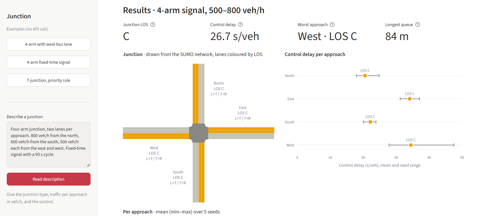

# JunctionLab

Plain-language junction descriptions to SUMO traffic simulations



See [docs/product-brief.md](docs/product-brief.md), [docs/method.md](docs/method.md) and [docs/plan.md](docs/plan.md).

## Development

Python 3.12. SUMO comes from the `eclipse-sumo` pip package, so no separate install is needed.

```sh
python -m venv .venv
.venv/Scripts/activate        # Windows; on Linux/macOS: source .venv/bin/activate
pip install -e ".[dev]"
ruff check . && ruff format --check .
pytest
```

Defaults live in `config.yaml`.

## App

From the repository root on Windows:

```sh
.venv\Scripts\python.exe -m streamlit run app\streamlit_app.py
```

The three examples work without an API key. Reading a description needs `GROQ_API_KEY`.

## Command line

```sh
python -m junctionlab list                      # bundled examples
python -m junctionlab run four_arm_signal       # simulate 5 seeds, print delay/queue/throughput/LOS
python -m junctionlab run my_scenario.json --seeds 1,2 --out runs/test
python -m junctionlab webster                   # check simulated delay against Webster (about 20 s)
python -m junctionlab interpret "Crossroads, 800 veh/h from the north, ..." --out s.json --run
```

`interpret` runs on the **free Groq tier** and needs `GROQ_API_KEY` in `.env` (see `.env.example`) or in the environment. The Streamlit app uses the same path. It uses at most 5 calls per session and 50 per day, and Groq's own rate limits also apply. Everything else works without a key.

If the model had to choose a reading of the demand (for example, counts with no time period), `--run` stops and shows its note. Correct the description, or add `--confirm-demand` to accept that reading.

To use Anthropic instead, set `llm.provider: anthropic` in `config.yaml` and add `ANTHROPIC_API_KEY`. This is a paid API.

Tests make no API calls. To run the one live test:

```sh
JUNCTIONLAB_LIVE_LLM=1 pytest tests/test_llm.py -k live
```
